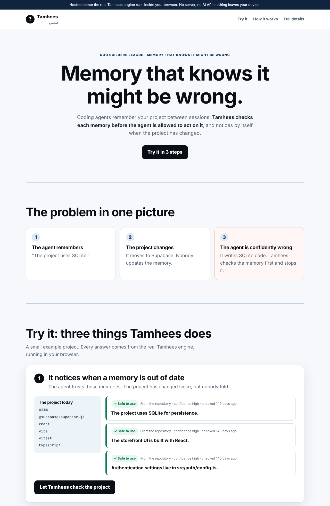

# Tamhees

**Memory under scrutiny.** Tamhees checks what an AI coding agent remembers *before* that
memory is allowed to guide an action.

*Tamhees* (تمحيص) is Arabic for careful examination.

[**Live demo**](https://weweb12.github.io/tamhees/) · [Submission overview](SUBMISSION.md) · [Architecture](docs/ARCHITECTURE_SNAPSHOT.md) · [Two-year thesis](docs/THESIS.md) · [FAQ](docs/FAQ.md)

[](https://github.com/weweb12/tamhees/actions/workflows/demo.yml)




## Why

Coding agents carry memory between sessions: instruction files, notes, past decisions.
That memory goes wrong quietly:

- **Stale.** "The project uses SQLite" stays true in memory after the project moves to Supabase.
- **Overconfident.** A guess the agent made from one old mockup reads like an owner's decision.
- **Invasive.** Personal details picked up in a chat are kept long after they were needed.
- **Unexplained.** Nobody can tell where a remembered fact came from, or how sure it is.

More memory does not fix this. An agent needs to know which memories it can rely on.

## What Tamhees does

Every memory is stored as a **claim** with its source, confidence, verification status
(8 authority levels), freshness, scope, sensitivity and action permission. Before an agent
uses memory, Tamhees audits each claim with 15 deterministic rules and gives one of five
outcomes:

| Outcome | Meaning for the agent |
|---|---|
| `TRUST` | Safe to rely on. |
| `RECHECK` | Might be wrong or out of date: verify before relying on it. |
| `ASK_OWNER` | Not confirmed by the owner: may look and explain, must ask before changing anything. |
| `BLOCK_ACTION` | Contradicted by current evidence: must not act on it. |
| `FORGET_OR_REDACT` | Must not be kept or shown. |

The agent then receives a small, task-specific **context pack** under a hard token
budget. Every included claim says how sure it is and why it was chosen; every excluded
claim has a reason code. A validator rejects the whole pack rather than serve something
unsafe.

Tamhees can also **notice by itself** that a memory is wrong. `tamhees observe` reads the
project's manifests and checks technology, script and file-path claims against them.
"Forget that" erases the text everywhere and leaves only a tombstone.

## Quick start

Requires Node.js 22 or newer on macOS, Linux or Windows. Tamhees is installed from source.

```bash
git clone https://github.com/weweb12/tamhees.git
cd tamhees
npm ci                 # installs build tools and builds Tamhees
npm install -g .       # puts the `tamhees` command on your PATH
```

Then, in the project you want Tamhees to look after:

```bash
tamhees init
tamhees adapter install --agent claude      # or codex, antigravity, generic, mcp
tamhees remember "The project uses Postgres" --as repo --source package.json
tamhees observe --record                    # check memories against the repository
tamhees inspect                             # what is remembered, and how sure
tamhees context --task "add a database migration"
```

`tamhees adapter install` adds a short, clearly marked block to the agent's instruction
file (`CLAUDE.md`, `AGENTS.md`, …) that tells the agent how to use Tamhees. Text you wrote
in that file is never changed. For MCP clients, the generated `TAMHEES_MCP.md` has
ready-to-paste configuration for Claude Code, Cursor and VS Code.

To update, pull and run `npm ci` again. To uninstall, run `npm uninstall -g tamhees`.

## Commands

| Command | What it does |
|---|---|
| `tamhees init [dir]` | Create safe `.tamhees/` storage. |
| `tamhees remember "<claim>"` | Store a claim with provenance and freshness defaults (`--as`, `--source`, `--tags`, `--expires-in`, `--dry-run`). |
| `tamhees inspect [id]` | Show source, status, confidence, freshness, scope, evidence and the audit outcome in plain words. Read-only. |
| `tamhees observe [--record]` | Check claims against the repository and record `SUPPORTS` or `CONTRADICTS` evidence. |
| `tamhees forget <id>` | Redact: erase the text everywhere and keep a privacy-safe tombstone. |
| `tamhees revoke <id>` | Revoke: the claim can no longer guide action, and its prior state is archived. |
| `tamhees context --task "…"` | Compile a ranked, budgeted context pack (`--max-tokens`, `--format json\|markdown`, `--scope-input`). |
| `tamhees audit` | Run the full rule chain and append privacy-safe audit events. |
| `tamhees lifecycle begin\|finalize` | Controlled pre-task and post-task boundary for agents. |
| `tamhees memory list\|show\|apply` | Inspect claims or apply a strict JSON update candidate. |
| `tamhees evidence list\|add` | Inspect or add validated evidence. |
| `tamhees adapter list\|status\|install\|remove` | Manage the Codex, Claude Code, Antigravity, generic and MCP adapters. |
| `tamhees mcp serve` | Run the four-tool stdio MCP server. |
| `tamhees doctor [--fix]` | Diagnose a damaged store and repair it safely (damaged files are quarantined, never deleted). |
| `tamhees migrate bootstrap\|legacy-storage` | Import a Markdown claim ledger, or rename a legacy `.gptbrain/` store. |
| `tamhees benchmark run` | Run the deterministic benchmark. |

Run `tamhees --help` for every option.

## Design principles

- **Deterministic.** The same input always gives the same, explainable answer. No LLM judges memory.
- **Local-first.** No cloud service, account, API key or telemetry. Zero runtime dependencies.
- **Authority is earned.** An AI inference can never promote itself to an owner decision, and high confidence never overrides a safety gate.
- **Fail closed.** Reads stop rather than use a file they cannot validate; `tamhees doctor` explains why.
- **Private by default.** Secret-like content is refused before it is stored. Redaction removes text from records, archives and logs.
- **Tool-neutral.** Every adapter and the MCP server share one engine and one storage format.

## How it works

```
Agent ──► adapter / MCP ──► lifecycle ──► context compiler ──► audit rules ──► storage (.tamhees/)
                                              │                    │
                                     ranked, budgeted pack     evidence, observe
```

- **Write path:** strict JSON candidates are validated, checked for secrets and authority
  escalation, then written atomically with an archive and an append-only audit log.
  Writes are serialized by a project lock.
- **Retrieval path:** per-claim gates (privacy, revocation, conflict, expiry, scope,
  relevance), then scoring by relevance, authority, freshness and safety, a hard budget
  of whole claims, and a fail-closed validator.
- **Forgetting path:** expiry → `RECHECK`; contradicting evidence → `BLOCK_ACTION`;
  owner revocation → archived tombstone; privacy withdrawal → text erased.

See the [architecture snapshot](docs/ARCHITECTURE_SNAPSHOT.md) for all three paths and
the [protocol specification](docs/PROTOCOL_SPECIFICATION.md) for the schemas.

## Demo and benchmark

```bash
npm run dashboard      # local demo at http://127.0.0.1:8787/
npm run failure-test   # the real CLI through six ways memory goes wrong
npm run benchmark      # regenerate benchmark/results/
```

The [hosted demo](https://weweb12.github.io/tamhees/) runs the same engine modules in your
browser. Its answers are byte-identical to the local server, and nothing is sent anywhere.

The benchmark compares no memory, a single memory file, split files and Tamhees on 22
fixed scenarios. Tamhees gets 22/22 expected outcomes, 15/15 precision and zero unsafe or
secret exposures. Recall is 15/17: two relevant records are left out on purpose to stay
within the hard budget. These are reproducible results on fixed fixtures; they are not
universal claims.

## Development

```bash
npm ci
npm run verify         # typecheck, build and the full test suite
npm run site           # build the static hosted demo into _site/
```

```
src/
  core/        engine: storage, validation, audit rules, context, lifecycle, observe, doctor
  adapters/    Codex, Claude Code, Antigravity, generic and MCP adapters
  mcp/         stdio JSON-RPC server and tools
  dashboard/   local demo server and pages
  benchmark/   deterministic benchmark harness
  cli.ts       the tamhees command
test/          node:test suites, including an 18,000-case rule-combination check
web/           browser shims for the hosted demo
scripts/       failure test, static-site build, install check
benchmark/     fixed scenarios and committed results
docs/          architecture, protocol, threat model, decisions, thesis, FAQ
```

Design decisions and their reasons are recorded in [docs/DECISIONS.md](docs/DECISIONS.md).
Release history is in [CHANGELOG.md](CHANGELOG.md).

## Limits

Retrieval is lexical, widened only by fixed synonym and concept tables, not semantic.
Token counts are a deterministic estimate. Secret detection is pattern-based and cannot
catch every secret. Owner identity is declared, not cryptographically authenticated.
`observe` covers technology, script and path claims; other claims rely on evidence from
the agent. Agents must cooperate and call Tamhees. See the
[threat model](docs/THREAT_MODEL.md).

## License

Copyright © 2026. All rights reserved. No open-source license has been granted yet. See
[THIRD_PARTY_NOTICES.md](THIRD_PARTY_NOTICES.md) for the development dependencies.
