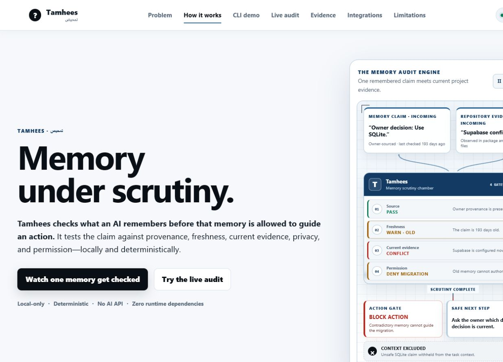
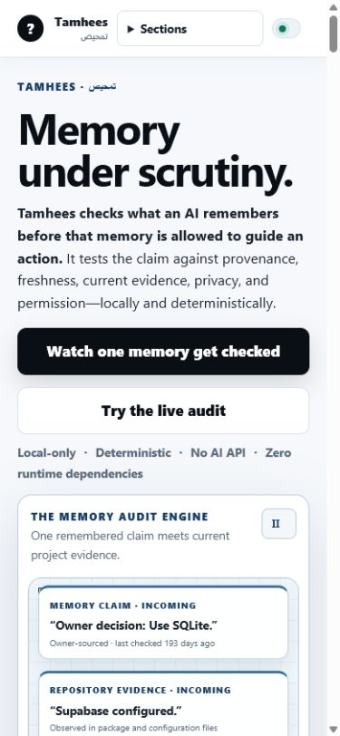

# Tamhees

**Memory under scrutiny.**

Tamhees checks what an AI remembers before that memory is allowed to guide an action. The name comes from the Arabic word تمحيص, used here to mean careful examination or scrutiny.

## What is this?

Tamhees is a local developer tool for auditing AI coding-agent memory. It treats remembered project information as evidence-backed claims rather than unquestioned truth.

When memory conflicts with current evidence, contains sensitive information, lacks sufficient support, or may be outdated, the system explains the problem and restricts unsafe action.

## The problem

AI coding agents use project instructions, memory files, and prior decisions to continue work across sessions. These sources can become:

- **Inaccurate** because the project changed.
- **Invasive** because unnecessary private information was retained.
- **Overconfident** because an inference was presented as confirmed truth.
- **Unsafe** because an agent acted without verifying conflicting evidence.
- **Tool-specific** because memory formats differ between AI products.
- **Difficult to audit** because the reason behind a remembered fact is missing.

Existing memory and instruction systems provide continuity, but continuity alone does not prove that remembered information remains correct or safe to use.

## Intended product (Version 1)

- **Tamhees engine**: Tool-neutral memory engine with deterministic audit rules.
- **tamhees CLI**: Command-line interface for initialization, memory management, context compilation, and auditing.
- **Structured local storage**: `.tamhees/` directory with atomic JSON memory records and JSONL audit logs.
- **Authority model**: Eight-status verification model distinguishing owner decisions from agent inferences.
- **Context compiler**: Task-specific context packs with explicit budgets and selection explanations.
- **Agent adapters**: Codex, Claude Code, Antigravity, and generic adapters with cross-adapter equivalence.
- **Local MCP adapter**: stdio-based Model Context Protocol integration.
- **Deterministic benchmark harness**: Measures retrieval precision, recall, budget compliance, authority protection, and more.
- **Local visual dashboard**: Browser-based project memory viewer and audit explorer.

## Current status

> **Version 1.0.0-rc.1 — Phase 9 is implemented, independently verified, and checkpointed locally. It remains an unpublished release candidate, not a final public release.**

Tamhees now includes the complete local Version 1 engine, CLI, storage, lifecycle, five adapters, four-tool stdio MCP surface, deterministic benchmark, loopback dashboard, release documentation, threat model, and dry-run-first distribution preparation. No remote, upload, deployment, publication, external service, telemetry, or runtime dependency exists. The candidate is not a final public release: Node 22 execution, real assistive-technology and physical-device review, judge-comprehension review, license/publication decisions, second-laptop portable review, and challenge submission remain owner or external gates.





Implemented commands:

- `tamhees init [directory]`: Initialize safe `.tamhees/` storage.
- `tamhees memory list|show|apply`: Inspect or apply controlled memory operations.
- `tamhees evidence list|add`: Inspect or add validated evidence.
- `tamhees context --task "..." [--max-tokens <n>] [--format json|markdown]`: Compile ephemeral ranked context under a hard budget.
- `tamhees audit`: Apply the complete precedence chain and append privacy-safe audit events.
- `tamhees lifecycle begin|finalize`: Use the controlled pre-task and post-task boundary.
- `tamhees migrate bootstrap|legacy-storage`: Run the bootstrap import or explicitly validate and rename one safe legacy `.gptbrain/` store to `.tamhees/` without merge or overwrite.
- `tamhees adapter list|status|install|remove|begin|finalize`: Manage all five local adapters.
- `tamhees mcp serve`: Run the four-tool JSON-RPC 2.0 stdio server.
- `tamhees benchmark run`: Run the deterministic benchmark.
- `npm run dashboard`: Build and start the loopback dashboard.
- `npm run verify`: Typecheck, build, and run the full suite.
## Design principles

- **Local-only**: No cloud services, accounts, API keys, or telemetry.
- **Zero runtime dependencies**: Core engine targets Node.js built-ins only.
- **Deterministic**: Same input always produces the same audit result.
- **Privacy-safe**: Raw SENSITIVE/SECRET retention candidates are rejected; legacy sensitive output is defensively redacted. Common secret-like patterns are rejected before memory or evidence persistence, and controlled redaction removes legacy raw content without copying it into archives or logs. Pattern matching is defensive but cannot guarantee detection of every possible secret.
- **Tool-neutral**: Works across different AI coding agents through thin adapters.
- **Auditable**: Every audit decision includes evidence and triggered rules.

## Repository structure

```
doubtful-memory/
├── package.json
├── tsconfig.json
├── src/
├── test/
├── examples/
│   ├── create-memory-candidate.json
│   └── repository-evidence.json
├── PROJECT_BRAIN.md              # Stable project identity and boundaries
├── PROJECT_STATE.md              # Current phase and working position
├── DECISIONS.md                  # Recorded decisions and reasoning
├── REQUIREMENTS_AND_ASSUMPTIONS.md  # Testable requirements and unverified assumptions
├── RISK_REGISTER.md              # Known risks and mitigations
├── AGENTS.md                     # Cross-agent governance rules
├── README.md                     # This file
├── .agents/
│   └── rules/
│       └── tamhees.md            # Antigravity workspace rule
├── docs/
│   ├── ARCHITECTURE.md           # Component boundaries and invariants
│   ├── PROTOCOL_SPECIFICATION.md # Memory and audit protocol schemas
│   └── IMPLEMENTATION_ROADMAP.md # Phased development checkpoints
└── memory/
    ├── MEMORY_CLAIMS.md          # Bootstrap project memory claims
    └── MEMORY_AUDIT.md           # Bootstrap audit history
```

## Local setup and verification

In the checked-out repository, install the locked development dependencies and build the local package:

```powershell
npm ci
npm run build
```

The package exposes only the `tamhees` executable. After placing this local package bin on `PATH`, these identity and initialization commands are exact and copyable:

```powershell
tamhees --help
tamhees --version
tamhees init
```

For repository development without a PATH install, the equivalent commands are:

```powershell
npm run tamhees -- --help
npm run tamhees -- --version
npm run tamhees -- init
```

Before migrating an existing project, run the pure preview, inspect the structured result, and then run the explicit migration:

```powershell
tamhees migrate legacy-storage --dry-run
tamhees migrate legacy-storage
```

A minimal real workflow uses strict JSON inputs rather than free-form shell content:

```powershell
tamhees init
tamhees memory apply --input .\examples\create-memory-candidate.json
tamhees evidence add --input .\examples\repository-evidence.json
tamhees audit
tamhees context --task "prepare the database migration"
```

Start the fixed-fixture local dashboard separately:

```powershell
npm run dashboard
```

No API key, account, hosted model, database, or external runtime network is required. The dashboard uses only local loopback HTTP. Its guided CLI sequence is a visual lesson over fixed safe fixtures and one canonical local audit request; it does not execute commands, accept arbitrary shell input, or write project memory.

### Phase 3 context budgets

`--max-tokens` accepts a decimal positive integer from 1 through 1,000,000. If omitted, the default is 2,048. The budget covers only the canonical agent-consumable selected-memory payload: memory ID, redacted statement, audit outcome, verification status, confidence, and output-safe tags. Ranking diagnostics, exclusions, warnings, and budget metadata remain visible outside that bounded payload.

Token counts use the deterministic local `utf8-bytes-ceil-div-4` estimator (UTF-8 byte length divided by four and rounded up, minimum one). This is a capacity estimate, not an exact vendor tokenizer. Complete memory statements are never truncated; when a ranked contribution does not fit, it and lower-ranked candidates are excluded as `over-budget`. A budget too small for one complete unit returns a valid explained empty pack.

Task-specific eligibility requires at least one positive exact Unicode-NFKC-normalized, case-folded, non-common lexical or tag match. Substring-only and common-word-only matches are irrelevant. Authority, freshness, and safety rank only eligible records; unrelated records never consume budget. This is deterministic lexical retrieval, not semantic retrieval.

## Controlled update workflow

Coding agents should not edit `.tamhees/` records directly. They submit a JSON update candidate matching `docs/PROTOCOL_SPECIFICATION.md`, then invoke:

```powershell
node dist/src/cli.js memory apply --input .\candidate.json
```

The engine validates schema, authority, evidence references, optimistic concurrency, privacy, paths, archive behavior, index consistency, and audit logging. A failed candidate does not silently overwrite canonical memory.

The `examples/` files are safe templates for coding agents. Copy and edit them for the target project rather than treating their example timestamps and IDs as current facts.

Owner-confirmed promotion is intentionally two-step: create a lower-authority memory, attach explicit owner-instruction evidence, then propose the promotion. An agent's claim that it has owner authority is not sufficient by itself.

## Phase 4 controlled lifecycle

`lifecycle begin` validates local storage, invokes the Phase 3 compiler, and returns a lifecycle ID plus JSON or Markdown context. The task and complete context pack are ephemeral. Only selected memory IDs, controlled exclusion codes, budget arithmetic, timestamps, state, and safe audit references are stored in `.tamhees/episodes/`.

`lifecycle finalize` accepts this strict envelope and reuses Phase 2 `UpdateCandidate` objects:

```json
{
  "schemaVersion": "1.0.0",
  "lifecycleId": "lc-example",
  "proposer": { "type": "AGENT", "id": "safe-agent-id" },
  "proposedUpdates": [],
  "reason": "Optional privacy-safe reason"
}
```

Every candidate receives `APPLIED`, `HELD_FOR_OWNER`, `REJECTED`, or `NO_CHANGE`. Authorized items are applied independently in input order through the canonical mutation boundary. The engine journals `FINALIZING` before mutation; interrupted work requires controlled recovery and is never replayed automatically. Identical completed input is idempotent, while different replay is rejected. Owner-policy proposals without sufficient owner evidence are held and cannot mutate memory.

`migrate bootstrap` is the one-time deterministic migration for the documented Markdown claim ledger. It maps legacy vocabulary explicitly, validates every claim before writing, preserves IDs and authority, retains the source Markdown, rejects unsafe source paths, and uses staged recovery markers to reconcile an audit/completion interruption without duplication.

## Phase 5–7 adapters, MCP, and benchmark

The shared adapter registry contains exactly `codex`, `antigravity`, `claude`, `generic`, and `mcp`. All five use the same lifecycle API and canonical storage. Managed installs are project-local, dry-run capable, atomic, idempotent, path-safe, preserve bytes outside the managed block, and reject malformed or user-modified managed content without changing the target.

The MCP adapter is a limited local stdio-only JSON-RPC 2.0 server. It uses Node.js built-ins, one UTF-8 JSON object per line, protocol revision `2025-11-25`, a bounded rolling 4,096-request duplicate-ID window, and exactly four tools for initialization, begin, finalize, and privacy-safe status. It has no HTTP listener, global configuration, SDK dependency, or runtime network request; this is the documented project subset, not a claim of full MCP feature coverage.

`npm run benchmark` regenerates `benchmark/results/v1.0.0-rc.1.json` and `.md` from 22 fixture-authored deterministic scenarios without rewriting the fixture. It compares no memory, a monolithic GPTBrain baseline, simple split files, and the production Tamhees compiler. Undefined metrics are `null` and excluded from applicable means. Detection, prevention, exposure, escalation, abstention, budget, and exact outcome are separate. Tamhees records 15/15 micro precision, 15/17 micro recall (two safe relevant records are deliberately excluded by the hard budget), 22/22 abstention correctness, 22/22 exact outcome correctness, and zero unsafe or secret exposures.

## Phase 8 local dashboard

```powershell
npm ci
npm run verify
npm run dashboard
```

Open the exact printed `http://127.0.0.1:8787/` URL. For the primary demonstration, select **Repository conflict**, run the audit, and inspect `BLOCK_ACTION`, `DM-RULE-CONFLICT-001`, the contradictory evidence, action consequence, owner next step, and `conflicted` context exclusion. The remaining scenarios cover stale, revoked, inferred, secret-like, budget-constrained, and supported memory.

Fixtures are fake and fixed. Results come from production audit/context functions, benchmark values come from the SHA-256-checked committed artifact, and execution creates no repository memory or persisted context.
## Next planned work

The exact next action after local private-package inspection is owner testing on the second Windows x64 laptop. Challenge-submission preparation requires separate authorization. Do not push, upload, publish, deploy, configure a remote, choose a public license, or call the candidate final before the remaining gates pass.

## Local release preparation

After the independently verified Phase 9 checkpoint, review `docs/RELEASE_CHECKLIST.md`, then dry-run the path-safe workflow to an output directory outside this repository:

```powershell
npm ci
npm run verify
npm run release:prepare -- -OutputDirectory C:\tmp\tamhees-release -DryRun
```

A real private archive additionally requires `-NodeRuntimeDirectory` pointing to an existing local Windows x64 runtime directory containing only the reviewed `node.exe` and its complete `LICENSE` or `LICENSE.txt`. The workflow produces one `Tamhees-Portable-Website-v1.0.0-rc.1-Windows-x64.zip`, refuses repository-contained output and existing artifacts unless `-Force` is explicitly selected, validates every entry, embeds stable per-file SHA-256 values, and creates no source archive, public release, or upload.
## Runtime requirements

- **Minimum**: Node.js 22
- **Development**: Node.js 24

Node 20 and earlier versions are end-of-life and will not be supported.

## Doo challenge

This project was initially inspired by the Doo challenge ("Memory That Knows It Might Be Wrong"). The challenge remains an active delivery target.

> **Important**: The detailed challenge brief, exact judging criteria, deadline year/timezone, and submission fields remain unverified. These are tracked as unverified assumptions in the project documentation. The product is designed for independent usefulness beyond the challenge.

## License

`UNLICENSED`. All rights reserved; no public license has been granted. See `THIRD_PARTY_NOTICES.md`. Selecting a public license requires explicit owner approval.
