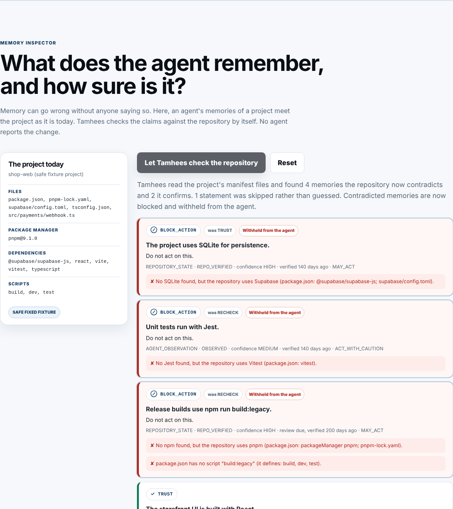

# Tamhees: DOO Builders League submission

**Challenge:** Memory That Knows It Might Be Wrong
**Live demo:** https://weweb12.github.io/tamhees/ (opens instantly; the real engine runs in your browser)
**Repository:** https://github.com/weweb12/tamhees

> Tamhees (تمحيص, "scrutiny") checks what an AI remembers *before* that memory is
> allowed to guide an action. It is built for coding agents, where wrong memory turns
> straight into wrong code. Every memory is a claim with a source, confidence,
> freshness, scope, privacy level and permission. Contradicted memories are blocked,
> stale ones are rechecked, guesses go to the owner, and revoked ones are forgotten.

## Try it in two minutes

**In the browser:** open the live demo. The front page is one short story with three
buttons; every answer comes from the real engine running in your browser.
1. **Let Tamhees check the project**: "The project uses SQLite" was trusted. Tamhees reads
   the project, sees Supabase, and blocks it. Nobody had to report the change.
2. **Forget this**: a memory about the owner is erased for good; only a tombstone remains.
3. **Can the agent redesign the app based on this?**: a confident AI guess is not the
   owner's approval, so the agent must ask first. This is the "I might be wrong" moment.

**Full details** (one click from the front page) has everything else: all seven memory
checks, the command-line lesson, the benchmark and the limits.

**From a clean clone** (Node.js 22+, macOS / Linux / Windows):

```bash
npm ci
npm run verify          # typecheck + build + 408 tests
npm run failure-test    # contradiction, staleness, AI guess, privacy revocation, secret refusal, self-detection
npm run dashboard       # the same demo, served locally on 127.0.0.1:8787
```



## "What do you remember about me?"

In a coding agent, "me" is the project owner: their decisions ("we use Supabase"), their
preferences ("no deploys on Fridays"), and personal details that slip into chats ("works
from home on Sundays"). Tamhees stores each one as a claim with its source and how sure it
is, shows them all in plain words (`tamhees inspect`, and the demo's Inspector), never lets
an AI guess pass as the owner's decision, and on "forget that" erases the text and keeps
only a tombstone.

## The brief, point by point

| The brief asks for | Where it is |
|---|---|
| A memory layer that tags each fact with **source, confidence, freshness, scope** | Every record in `.tamhees/memories/records/` carries `source`, `confidence` + `verificationStatus` (8 authority levels), `freshness` (`lastVerified` / `reviewAfter` / `expiresAfter`), `scope` (project or restricted to environment / component / path), plus `sensitivity` and `actionPermission`. See [Architecture snapshot](docs/ARCHITECTURE_SNAPSHOT.md). |
| On retrieval, the agent **shows what it's relying on and how sure it is** | `tamhees context` (and MCP `tamhees_begin_task`) returns a pack where every selected claim lists its audit outcome, verification status, confidence and why it ranked, and every excluded claim lists a reason code. Shown in the demo under *Ephemeral task context*. |
| A **forgetting policy** for stale, contradicted or user-revoked memories | Expired → `RECHECK` and excluded. Contradicting evidence → `BLOCK_ACTION` and excluded. Owner revocation → `REVOKED` tombstone, prior state archived. Privacy withdrawal → `REDACT`: raw text erased everywhere, not archived, safe audit metadata kept. |
| The memory **notices** it might be wrong | `tamhees observe` checks claims against the repository by itself: "uses SQLite" against dependencies, "npm run build:legacy" against package.json scripts, and a remembered file path against whether the file still exists. It records SUPPORTS or CONTRADICTS evidence, and contradicted memories are blocked. Step 6 of `npm run failure-test`. |
| A demo where the memory says **"I might be wrong"** and acts accordingly | Demo: *AI guessed without approval* → `ASK_OWNER` (the agent may look and explain but must not change anything), and *Memory became stale* → `RECHECK`. CLI: step 3 of `npm run failure-test`. |

## Deliverables

| Deliverable | Link |
|---|---|
| Working build | This repository + the live demo above |
| 90-second walkthrough | Linked in the submission form |
| Architecture snapshot: write, retrieval and forgetting paths | [docs/ARCHITECTURE_SNAPSHOT.md](docs/ARCHITECTURE_SNAPSHOT.md) |
| Failure test: contradictory facts, stale data, privacy revocation | [`scripts/failure-test.mjs`](scripts/failure-test.mjs), run with `npm run failure-test` (also runs in CI) |
| Two-year thesis (≤300 words) | [docs/THESIS.md](docs/THESIS.md) |

## How it maps to the judging criteria

- **Conceptual clarity:** one model covers accuracy (evidence and freshness), privacy
  (sensitivity, refusal at write time, redaction) and overconfidence (authority levels;
  confidence never overrides a gate).
- **Technical depth:** real storage (atomic per-claim JSON files, archive and
  append-only audit log), retrieval (gated, scored, hard-budgeted, fail-closed
  validation, deterministic synonym and concept matching), forgetting (expiry,
  contradiction, revoke, redact) and self-detection (`tamhees observe` reads the
  project's manifests and contradicts stale claims itself). No embeddings and
  no vector store: 15 deterministic audit rules with stable IDs.
- **Demo quality:** the hosted demo runs the unchanged engine modules in the browser.
  Its answers match the local Node server byte for byte across all 7 scenarios.
- **Failure thinking:** `npm run failure-test` drives the real CLI through six failure
  cases and asserts each outcome. When the store itself is damaged (a merge conflict in
  `.tamhees/`, a crash mid-write), `tamhees doctor` explains it and `--fix` repairs it
  without deleting anything. An exhaustive suite checks 18,000 combinations of
  authority, permission, privacy, freshness and evidence for safety invariants. It also found a real defect (an expired claim behind a
  caution permission could break retrieval), which is now fixed with a regression test.
- **Future thesis:** [docs/THESIS.md](docs/THESIS.md).

**Bonus signals.** *Memory inspector:* every memory on the front page shows where it
came from, how sure it is and when it was checked; the **Inspector** in Full details, and
`tamhees inspect` in the CLI, show all of them. *Privacy controls:* demonstrated, not
claimed. Step 2 on the front page erases a memory about the owner for good, the same as
`tamhees forget <id>`. Also the *Sensitive value appeared* check in Full details and steps
4–5 of the failure test.

## Notes for judges

**Also included:** a CLI, a four-tool local stdio MCP server, adapters for Codex, Claude
Code, Antigravity and generic agents (one shared engine), and a deterministic benchmark
(22 fixed scenarios: 22/22 expected outcomes, zero unsafe or secret exposures, compared
against no-memory, single-file and split-file baselines).

**Key decisions.** Deterministic rules instead of an LLM judging memory, so outcomes are
reproducible and explainable. Local-first with zero runtime dependencies. Memories are
claims rather than notes. AI inference can never promote itself to owner authority.
Context budgets select whole claims and never truncate. The context validator fails
closed. The hosted demo needs no server, so it has no secrets and sends nothing anywhere.

**Out of scope / honest limits.** Lexical (not semantic) retrieval, widened only by fixed
synonym and concept tables. Pattern-based
secret detection. Owner identity is declared, not cryptographically authenticated. Concurrent writers
are serialized by a project write lock; manual file edits bypass it. `tamhees observe` checks technology, script and path claims
against the repository itself, but other kinds of claims still rely on evidence
supplied by the calling agent. The audit report names the first rule in precedence order,
so an expired claim with a caution permission is reported as `RECHECK` (caution) rather
than "expired". Retrieval still excludes it as expired. See
[docs/THREAT_MODEL.md](docs/THREAT_MODEL.md) and the *Limitations* section of the demo.

**AI tools used.** Building Tamhees with AI agents is where the idea came from, and AI
was used throughout. **ChatGPT** for planning, design reviews and writing the step-by-step
prompts for the coding agent. **Antigravity** (Google's agent IDE) as the development agent
that implemented and verified the engine up to 1.0.0-rc.2. **Claude** for the post-rc.2
reliability pass (real-repository trials, concurrency, recovery, the exhaustive rule
suite), the hosted demo and these submission documents. Every change went through tests;
design decisions and their reasons are recorded in [docs/DECISIONS.md](docs/DECISIONS.md).
