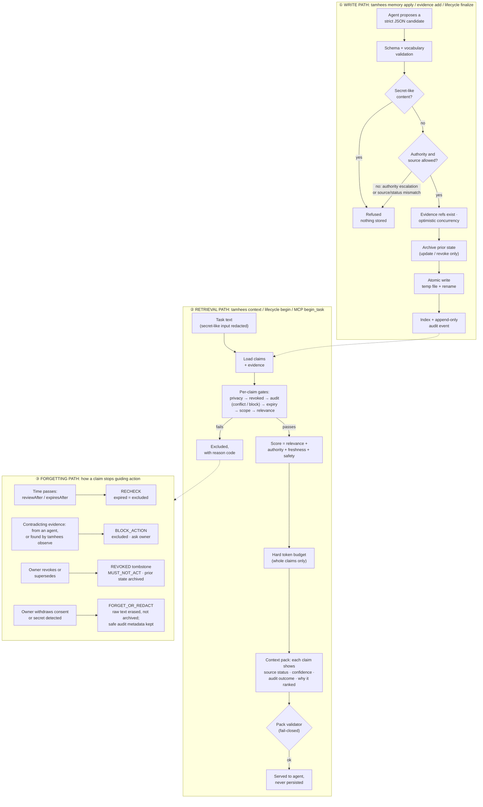

# Architecture snapshot: write, retrieval and forgetting paths

A one-page overview. The full design is in [ARCHITECTURE.md](ARCHITECTURE.md); the
memory and audit schemas are in [PROTOCOL_SPECIFICATION.md](PROTOCOL_SPECIFICATION.md).

Every remembered fact is one JSON claim in `.tamhees/memories/records/`, tagged with:

| Tag | Field | Example |
|-----|-------|---------|
| Source | `source.type`, `source.reference` | `REPOSITORY_STATE` · `package.json` |
| Confidence | `confidence` + `verificationStatus` | `HIGH` · `INFERRED` (8 authority levels, from `OWNER_CONFIRMED` down to `REVOKED`) |
| Freshness | `freshness.lastVerified`, `reviewAfter`, `expiresAfter` | verified 20 days ago, expires in 90 |
| Scope | `scope` | `PROJECT`, or `RESTRICTED` to an environment / component / path |
| Permission | `actionPermission` | `MAY_ACT` … `ASK_BEFORE_CHANGE` … `MUST_NOT_ACT` |
| Privacy | `sensitivity` | `PUBLIC`, `INTERNAL`, `SENSITIVE`, `SECRET` |

## The five outcomes an agent can receive

| Outcome | Meaning for the agent | Typical trigger |
|---------|----------------------|-----------------|
| `TRUST` | Use it within its permission | Current, supported, owner- or repo-verified |
| `RECHECK` | "I might be wrong": verify before acting | Past review date, expired, act-with-caution, weak evidence |
| `ASK_OWNER` | "I'm guessing": get approval first | AI inference, owner claim without owner evidence |
| `BLOCK_ACTION` | Do not act on this | Contradicting evidence, revoked, must-not-act |
| `FORGET_OR_REDACT` | Must not be kept or shown | Secret-like content, owner privacy revocation |

Rules are fixed in source with stable IDs (`DM-RULE-*`) and applied in a documented
precedence order, so the same inputs always produce the same outcome. High
confidence never bypasses an authority, freshness, privacy, conflict or revocation gate.

## Where each path lives

| Path | Code | Proof |
|------|------|-------|
| Write | `src/core/mutations.ts`, `validation.ts`, `privacy.ts`, `atomic-write.ts`, `evidence.ts` | `test/mutations-and-audit.test.ts`, `test/scope-and-bundles.test.ts` |
| Retrieval | `src/core/context.ts`, `scope.ts`, `lifecycle.ts` | `test/context-*.test.ts`, `test/regression-expired-permission.test.ts` |
| Forgetting | `src/core/audit.ts` (rules), `mutations.ts` (REVOKE / REDACT), `quick.ts` (`forget` / `revoke`) | `test/mutations-and-audit.test.ts`, `test/quick-commands.test.ts`, `npm run failure-test` |
| Self-detection | `src/core/observe.ts` (`tamhees observe`) | `test/observe.test.ts`, step 6 of `npm run failure-test` |
| Agent access | `src/adapters/*`, `src/mcp/*` (4-tool stdio MCP) | `test/adapter*.test.ts`, `test/mcp-*.test.ts` |
